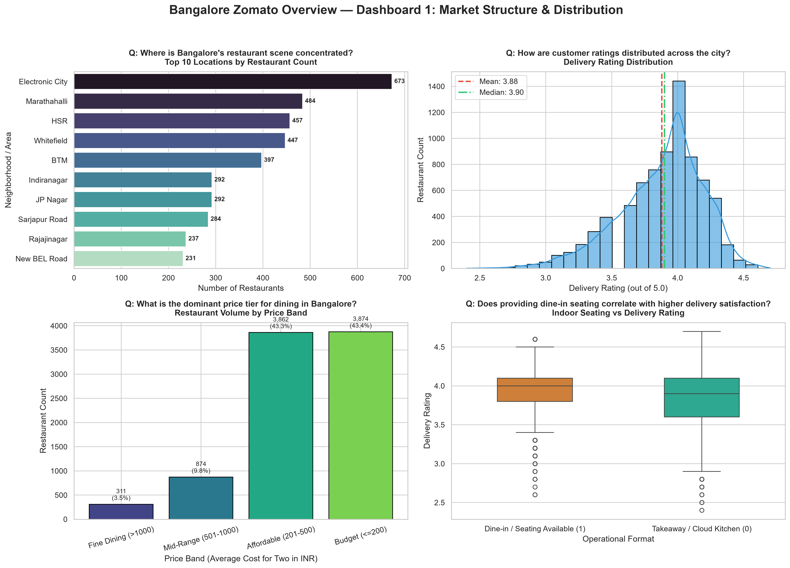
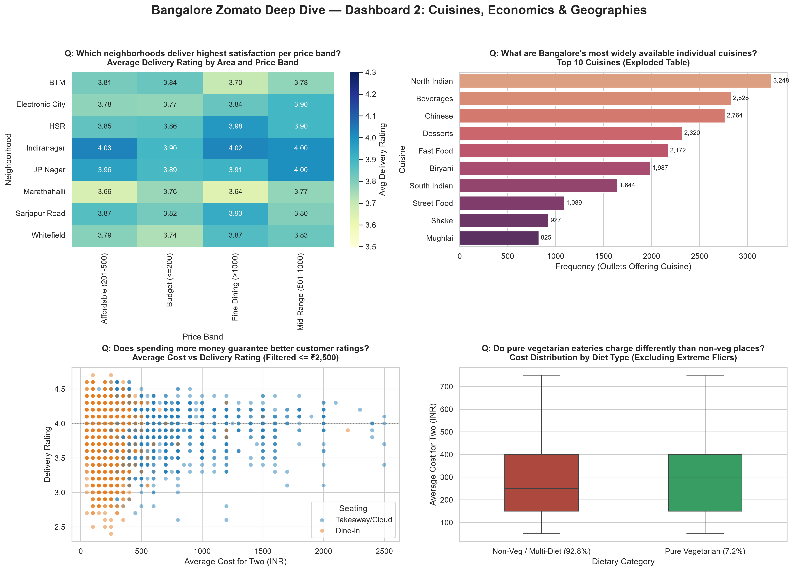
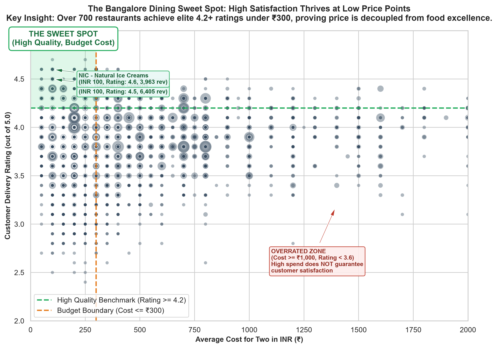

# 🍽️ Bangalore Zomato Exploratory Data Analysis (EDA)

A comprehensive 7-day exploratory data analysis on the Bangalore Zomato restaurant ecosystem. This project revises and consolidates core Data Analytics competencies from Months 1 and 2 (NumPy, Pandas, Matplotlib, and Seaborn).

---

## 📌 Project Architecture & Workflow

Every stage follows the rigorous analytics framework:
```
QUESTION -> INSPECT -> CLEAN -> ENGINEER -> ANALYZE -> VISUALIZE -> COMMUNICATE
```

| Day | Script | Primary Focus | Output Artifact |
| :--- | :--- | :--- | :--- |
| **Day 1** | `day1_inspect.py` | Read-only inspection, missingness, duplicate analysis, types | `data_dictionary.csv`, Top 8 Problems |
| **Day 2** | `day2_clean_types.py` | Snake_case standardization, whitespace strip, type coercion, deduplication | `zomato_stage1.csv` |
| **Day 3** | `day3_features.py` | Multi-value cuisine splitting, price/rating/popularity bands, IQR outliers | `zomato_features.csv`, `zomato_cuisines_long.csv` |
| **Day 4** | `day4_analysis1.py` | Groupby, multi-aggregations, crosstabs, pivot tables | 7 Formatted Question Answers |
| **Day 5** | `day5_analysis2.py` | Advanced boolean filtering (`isin`, `~`, `str.contains`, `between`), correlations | Best Value, Overrated, Chain Analysis |
| **Day 6** | `day6_visuals.py` | Subplot dashboards, heatmaps, distributions, and annotated story chart | `outputs/*.png` (3 high-res charts) |
| **Day 7** | `day7_verify.py`, `FINDINGS.md` & `README.md` | Statistical verification audit, executive synthesis, and reflection | 8 Verified Findings & Project Documentation |

---

## 📊 Visual Dashboards & Key Visualizations

### 1. Market Structure & Distribution Overview (Dashboard 1)

*Covers the geographic concentration of eateries across IT corridors (Electronic City, Marathahalli, HSR), delivery rating distributions, price band percentages, and the impact of indoor seating.*

---

### 2. Deep Dive: Cuisines, Economics & Geographies (Dashboard 2)

*Explores locality-by-price satisfaction dynamics via heatmaps, true exploded cuisine rankings (North Indian, Beverages, Chinese), cost vs. rating scatter, and dietary pricing variations.*

---

### 3. Story Chart: The Bangalore Dining Sweet Spot

*Visualizes Bangalore's culinary value proposition: over 700 budget-friendly eateries (<= ₹300) attain elite ratings (>= 4.2), proving culinary quality is completely decoupled from high price tags.*

---

## 🚀 How to Run the Project

You can run individual day scripts independently or run the entire pipeline end-to-end:

### Run Everything End-to-End:
```powershell
python mini.py
```

### Run Day by Day:
```powershell
python day1_inspect.py
python day2_clean_types.py
python day3_features.py
python day4_analysis1.py
python day5_analysis2.py
python day6_visuals.py
```

---

## 💡 Student Reflection & Methodological Comparison

### Reflection:
1. **What I would do differently:** Profile coordinate/geolocation data or spatial mapping (using GeoPandas/Folium) to map delivery radius density instead of relying solely on neighborhood string names.
2. **Mistake 1 made & fixed:** Attempted to count multi-value cuisines directly with `value_counts()`, which treated composite strings as unique categories; fixed by splitting and using `.explode()` to build a long table.
3. **Mistake 2 made & fixed:** Encountered `'-'` placeholder strings in rating columns that broke math functions; fixed by coercing to `np.nan` and casting to `float64`.
4. **Mistake 3 made & fixed:** Dropping duplicate restaurant names initially threatened to delete multi-branch chains; fixed by establishing strict deduplication only on `['name', 'full_address']`.
5. **One thing I now do automatically:** Always compute both `mean` AND `median` when summarizing real-world metrics like reviews and cost to avoid being fooled by extreme right-skewed outliers.

### Comparison with Netflix EDA:
- In the **Netflix EDA**, missing values were handled primarily through simple bulk fills or dropping rows, and composite genres were analyzed at surface level.
- In this **Zomato EDA**, missingness was handled through column-specific justification (`DECISION` comments), rating placeholders were properly coerced to `NaN`, true physical branch duplication was distinguished from identical scrape redundancy, and multi-cuisine entries were properly exploded into long-format data.
