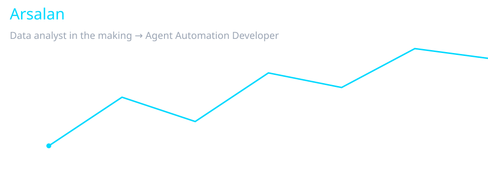
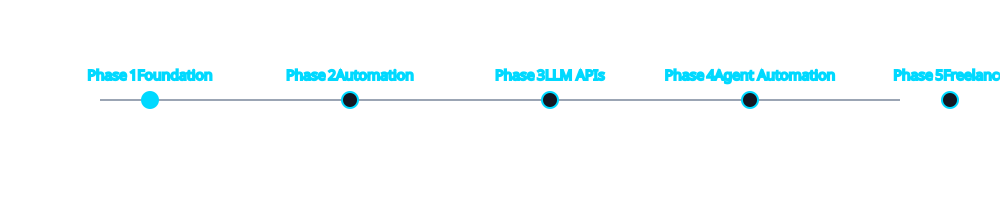
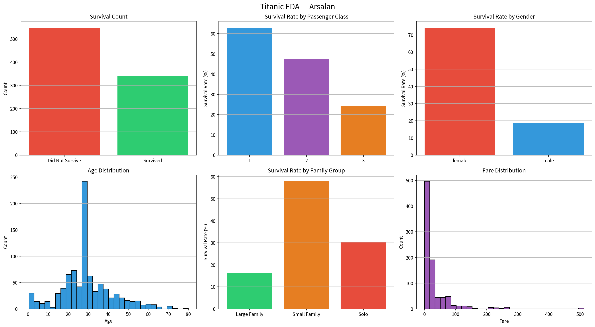
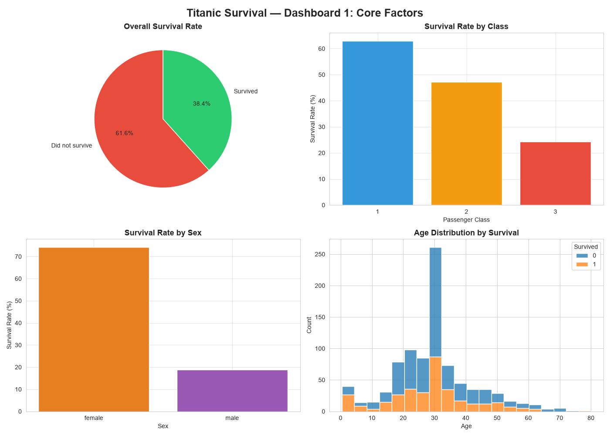
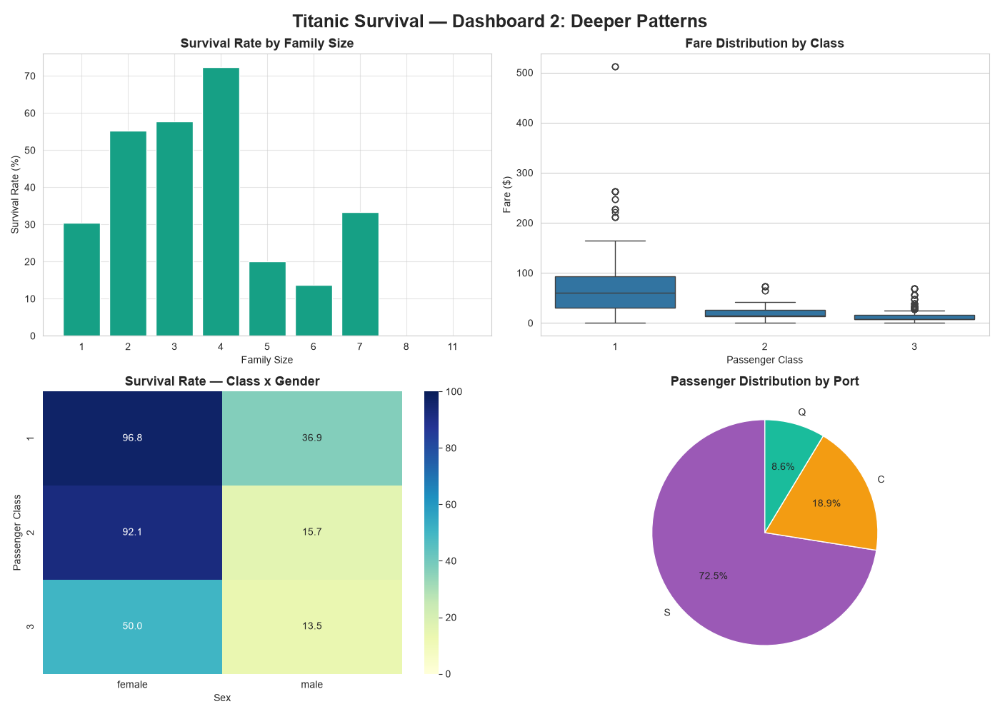

# <picture>
#   <source srcset="assets/hero.svg" media="(prefers-color-scheme: dark)">
#   <source srcset="assets/hero.svg" media="(prefers-color-scheme: light)">
#   
# </picture>

---

[](https://www.python.org/)
[](https://pandas.pydata.org/)
[](https://numpy.org/)
[](https://matplotlib.org/)
[](https://seaborn.pydata.org/)
[](https://jupyter.org/)
**Phase 1 – Foundation**

---

**Mission** – I’m a 2nd‑year AI student building a solid data‑analytics foundation while preparing to design autonomous LLM‑driven pipelines.

---

<picture>
  <source srcset="assets/roadmap.svg" media="(prefers-color-scheme: dark)">
  <source srcset="assets/roadmap.svg" media="(prefers-color-scheme: light)">
  
</picture>

---

### Skills

| Data wrangling | Analysis | Visualization | Tooling |
|---------------|----------|---------------|--------|
| `pandas` – cleaning, groupby, pivot | `NumPy` – vectorised math | `Matplotlib` – static plots | `Jupyter` notebooks |
| `pandas` – joins, concat |  | `Seaborn` – statistical charts | `git` – version control |

---

### Project Gallery

| Project | Screenshot | Description |
|--------|------------|-------------|
| **NumPy basics** |  | Core NumPy exercises (array ops, broadcasting). |
| **Pandas cleaning** |  | Real‑world cleaning pipelines (Titanic, Wine, Netflix). |
| **Matplotlib‑Seaborn dashboards** |  | Multi‑panel Titanic visual story (9 charts). |
| **Matplotlib‑Seaborn dashboards** |  | Continuation of the Titanic dashboard series. |

---

### Repository map

```
data‑analytics/
├─ assets/
│  ├─ hero.svg
│  ├─ roadmap.svg
│  ├─ titanic_eda.png
│  ├─ titanic_dashboard_1.png
│  └─ titanic_dashboard_2.png
├─ Matplotlib‑Seaborn/
│  └─ … (weekly notebooks & scripts)
├─ numpy/
│  └─ … (array tutorials)
├─ pandas/
│  └─ … (cleaning & aggregation)
├─ requirements.txt
├─ README.md
└─ .gitignore
```

---

### Quick‑start (PowerShell)

```powershell
# Clone the repo
git clone https://github.com/24pwai0015-max/data-analytics.git
cd data-analytics

# Create a virtual environment
python -m venv .venv
.\.venv\Scripts\Activate.ps1

# Install dependencies
pip install -r requirements.txt

# Run a demo script (Titanic EDA)
python pandas/titanic_eda.py
```

---

### How I learn
1. Predict the outcome.
2. Struggle for ~15 min.
3. Review docs / error messages.
4. Document findings in `notes.md`.
5. Push the updated notebook/script to GitHub.

---

### Current focus & next steps
- **In‑progress:** Full EDA on a new Kaggle dataset (clean → visual pipeline).
- **Next:** Implement a **time‑series** notebook (ARIMA/Prophet) and add a lightweight animated SVG for a sample forecast chart.

---

#### Footer

[🌐 My GitHub profile](https://github.com/24pwai0015-max)

---
